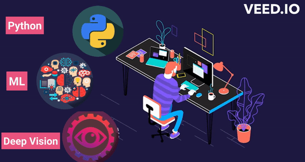
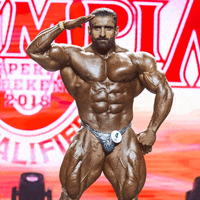
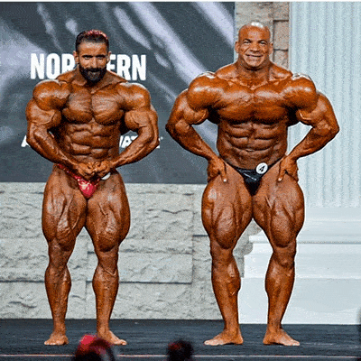
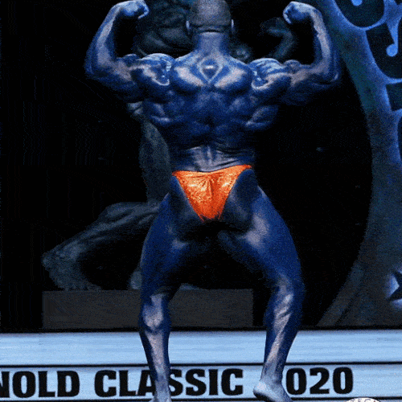
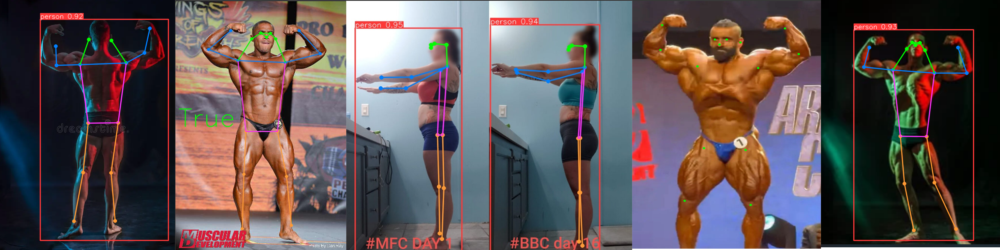
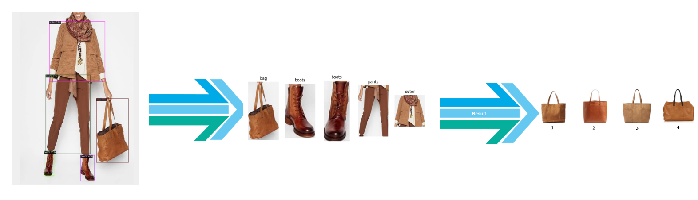

 

**Senior computer vision and machine learning engineer.** Since 2016 I've built vision systems that have to work outside the lab: 
on a phone in a gym, on a drone above a fire line, on a Jetson in a truck cab, on a clinician's review screen.

---

## About

- 🧠 **10+ years** across the whole model lifecycle: data and annotation, training, evaluation, inference optimization, deployment
- 🏥 **Medical AI:** weakly supervised 3D detection for MRI and CT, dental X-rays, brain-tumour segmentation (0.92 DSC on BraTS), skin-lesion triage on Jetson Nano
- 🛰️ **Remote sensing:** Prithvi-100M on Sentinel-2, small objects in large satellite scenes with SAHI, thermal drones for early fire detection (23% fewer false alarms)
- ⚡ **Real-time and edge:** under 15 ms on Jetson Orin Nano and under 30 ms on mobile, with ONNX Runtime, TensorRT and DeepStream
- 🏋️ **Led ML and computer vision at Sculp AI:** form feedback for 40+ exercises, body-composition segmentation (Dice 0.94)
- 🤖 **Now:** vision-language models (CLIP, DINOv2, SigLIP, Grounding DINO, SAM 3), retrieval and LLM pipelines for clinical data
- 🎯 *"Knowledge is not skill. Knowledge plus ten thousand hours is skill."*

 

---

## Experience

| Period | Role | Where | Focus |
|---|---|---|---|
| May 2025 – Oct 2026 | Computer Vision Researcher | Nova Vision (remote, part-time) | Multimodal clinical AI, VLM retrieval, LLM document pipelines |
| Jan 2023 – Feb 2025 | Computer Vision Engineer | VRVis GmbH (remote, flexible schedule) | Satellite, UAV and thermal drone imagery |
| Feb 2022 – Mar 2024 | Head of ML & Computer Vision | Sculp AI (remote, full-time) | Real-time pose, body-composition segmentation, mobile deployment |
| Feb 2022 – Dec 2023 | Computer Vision Engineer | SoftwareMotion (remote, project-based) | ADAS tracking and driver monitoring on Jetson |
| Sep 2020 – Dec 2021 | Computer Vision Researcher | G42 Healthcare (remote, part-time) | MRI, CT, dental X-ray and skin-lesion analysis |
| Feb 2016 – Mar 2019 | AI Computer Vision Developer | AMA-CTRL (Shiraz, on-site) | Industrial monitoring and site-safety vision |

🎓 M.Sc. Computer Engineering (Artificial Intelligence), Amirkabir University of Technology (Tehran Polytechnic). Thesis: *Few-shot Cascade R-CNN for Human Forensic Age Estimation*.

---

## Foundation models, VLMs and LLMs

> Connecting perception models to language and retrieval.

| | What | Built with | Where |
|---|---|---|---|
| 🩺 | **Finding visually similar clinical cases:** embedding search so reviewers can pull up similar cases during triage | `CLIP` `DINOv2` `SigLIP` | Nova Vision |
| 🗣️ | **Masks from a text prompt:** text-guided localization and mask generation for image review and annotation | `Grounding DINO` `SAM 3` | Nova Vision |
| 📄 | **Clinical documents into structured records:** extraction of diagnoses, medications and lab results, plus retrieval-backed assistants for search, summaries and Q&A | `OCR` `LLMs` `RAG` | Nova Vision |
| 📚 | **Clinical knowledge assistant:** chunking, retrieval, reranking and answers grounded in the source material | `LLM` `RAG` | Independent prototype |
| 🔎 | **Search medical cases by text or image:** shared visual and text embeddings with a language-model layer that summarizes the evidence | `VLM` | Independent prototype |
| 🌍 | **Geospatial foundation models:** fine-tuned for forest-cover classification and other Earth-observation tasks | `Prithvi-100M` `Clay` | VRVis and research |

---

## Featured work

**62 searchable projects are on [aisoltani.github.io](https://aisoltani.github.io).** A few with pictures:

### Detecting medical targets from a handful of examples

Few-shot Cascade R-CNN for detection and segmentation in medical images. [Code](https://github.com/AISoltani/Mask_RCNN_ResNet_101_50)

  

### Super-resolution that helps find small medical targets

Super-resolution as a front end for 2D and 3D detection.

  

### Tracking muscle and fat change between training sessions

Muscle and fat segmentation with repeat-session alignment: Dice 0.94 and mAP@50 0.92 on the internal benchmark, with a distilled model under 35 MB for mid-range phones.

  
  &nbsp; &nbsp; &nbsp; &nbsp;
  
  &nbsp; &nbsp; &nbsp; &nbsp;
  

  

### Body pose, keypoints and shape from several models

Multiple body pose, point and shape estimation with MoveNet, PoseNet and MediaPipe.

  

### Thermal detection that ignores the colormap

A real-time hybrid YOLO-Transformer detector that stays reliable across thermal colormap settings.

  

### Small objects in whole Sentinel satellite scenes

Sliced inference with horizontal and oriented boxes, so large scenes can be processed without losing small targets.

  

### YOLOv11-EdgeSuite: detection and segmentation on Android

A mobile vision toolkit that runs YOLOv11 models on smartphones. [Code](https://github.com/AISoltani/Yolov11-Android-Tool-Kotlin)

  
  &nbsp; &nbsp; &nbsp; &nbsp;
  
  &nbsp; &nbsp; &nbsp; &nbsp;
  

### Fashion recommendations from a few examples

Few-shot recommendation that combines metric learning with lightweight content-based filtering.

  

### Density heatmaps from a few labelled examples

  

---

## Industrial vision systems

> Vision for smart infrastructure, site safety and traffic analytics.

<table align="center">
  <tr>
    <td align="center" width="50%">
       
      <b>Smart parking occupancy and analytics</b>
    </td>
    <td align="center" width="50%">
       
      <b>Vision-driven process automation</b>
    </td>
  </tr>
  <tr>
    <td align="center" width="50%">
       
      <b>Site safety: helmets, harnesses and restricted zones</b>
    </td>
    <td align="center" width="50%">
       
      <b>Traffic analytics and vehicle tracking</b>
    </td>
  </tr>
</table>

---

## Strengths & Skills

  

---

## Tech Stack

  
  
  
  
  
  
  
  
  
  
  
  
  

  
  
  
  
  
  
  

<b>Full stack</b>

| Area | Tools |
|---|---|
| **Computer vision** | OpenCV, MMDetection, MONAI, MediaPipe, Ultralytics YOLO, SAM / SAM 2 / SAM 3, Albumentations |
| **Deep learning** | PyTorch, TensorFlow, Keras, scikit-learn, Hugging Face Transformers |
| **Foundation models and LLMs** | CLIP, DINOv2, SigLIP, Grounding DINO, LangChain, LangGraph, LlamaIndex, RAG, PEFT/LoRA |
| **Edge and deployment** | ONNX Runtime, TensorRT (INT8), TensorFlow Lite, NVIDIA DeepStream, Jetson Nano/Xavier/Orin, Raspberry Pi, Android/Kotlin |
| **Geospatial** | GDAL, Rasterio, GeoPandas, TorchGeo, SAHI, Sentinel Hub, rioxarray, Prithvi, Clay |
| **MLOps** | Docker, FastAPI, MLflow, Comet, Neptune, Weights & Biases, AWS, Azure |
| **Data and annotation** | CVAT, Labelbox, Roboflow, active-learning review |

---

## Certificates

> Each one links to its verification page.

<b>AI in healthcare, machine learning and algorithms (16 certificates)</b>

| Course | Provider | Credential |
|---|---|---|
| **AI in Healthcare Specialization** | Stanford University | [Verify](https://www.coursera.org/account/accomplishments/specialization/R9C9W2YRK1WZ) |
| Introduction to Healthcare | Stanford University | [Verify](https://www.coursera.org/account/accomplishments/verify/MV4UYUOWYGTJ) |
| Introduction to Clinical Data | Stanford University | [Verify](https://www.coursera.org/account/accomplishments/verify/85BXCOE7ZWDI) |
| Fundamentals of Machine Learning for Healthcare | Stanford University | [Verify](https://www.coursera.org/account/accomplishments/verify/B1X7ZRZ7U7WY) |
| Evaluations of AI Applications in Healthcare | Stanford University | [Verify](https://www.coursera.org/account/accomplishments/verify/ZWEPEAF5WLJA) |
| AI in Healthcare Capstone | Stanford University | [Verify](https://www.coursera.org/account/accomplishments/verify/DN9UR5QS0Y3L) |
| Introduction to Medical Software | Yale University | [Verify](https://www.coursera.org/account/accomplishments/verify/64MM329IZ0NC) |
| Essentials of Global Health | Yale University | [Verify](https://www.coursera.org/account/accomplishments/verify/VDZZUE7065VT) |
| Breast Cancer | Yale University | [Verify](https://www.coursera.org/account/accomplishments/verify/DHYV19S7M35S) |
| **Machine Learning Specialization** | DeepLearning.AI and Stanford Online | [Verify](https://www.coursera.org/account/accomplishments/specialization/9YTCR5C6A57W) |
| Supervised Machine Learning: Regression and Classification | DeepLearning.AI and Stanford Online | [Verify](https://www.coursera.org/account/accomplishments/verify/U2S4BSCSTHK1) |
| Advanced Learning Algorithms | DeepLearning.AI and Stanford Online | [Verify](https://www.coursera.org/account/accomplishments/verify/H6OQV45C7N37) |
| Unsupervised Learning, Recommenders, Reinforcement Learning | DeepLearning.AI and Stanford Online | [Verify](https://www.coursera.org/account/accomplishments/verify/BYE5I5GSW96I) |
| Graph Search, Shortest Paths, and Data Structures | Stanford University | [Verify](https://www.coursera.org/account/accomplishments/verify/5S4RSTH8CABW) |
| Greedy Algorithms, Minimum Spanning Trees, and Dynamic Programming | Stanford University | [Verify](https://www.coursera.org/account/accomplishments/verify/LTDQ2550591R) |
| SmallTalk2 English Speaking Test | SmallTalk2 | [Verify](https://app.smalltalk2.me/cert/f7ddd517) |

---

## GitHub stats

<picture>
  <source media="(prefers-color-scheme: dark)" srcset="https://raw.githubusercontent.com/AISoltani/AISoltani/output/github-contribution-grid-snake-dark.svg">
  
</picture>

---

## Contact

  

Open to senior Generative AI, LLMs, VLMs, computer vision and machine learning roles, research collaborations and PhD opportunities.

  
  
  
  
  

  

